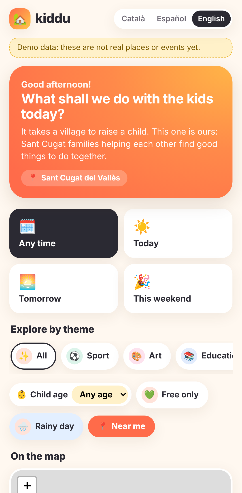
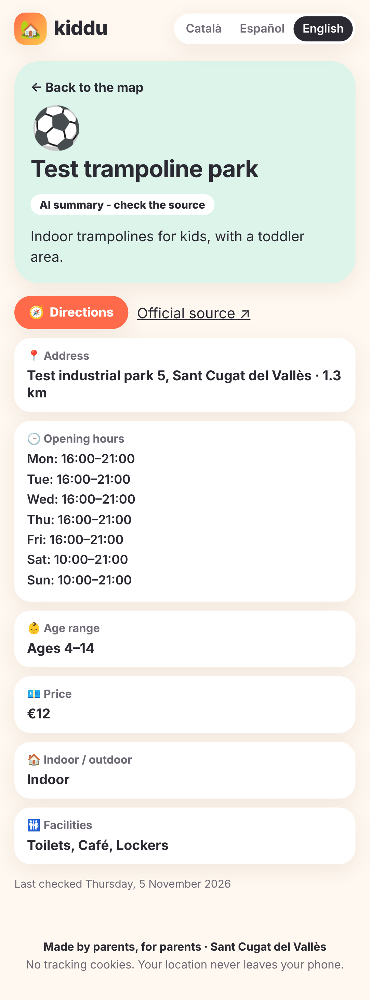
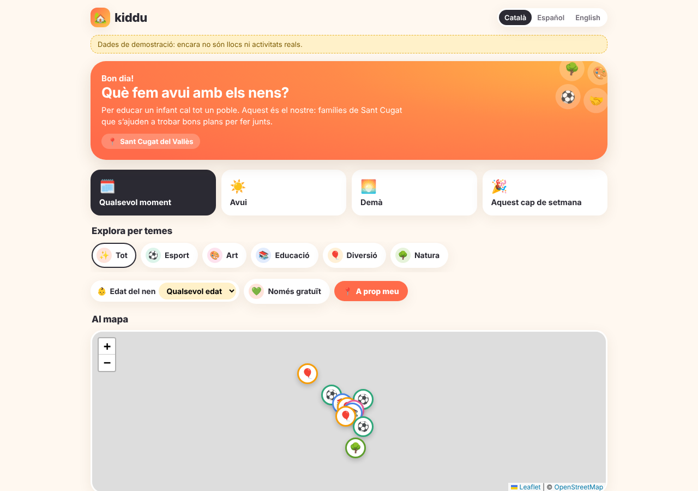

# Kiddu Sant Cugat

Website with places, events and activities for families in Sant Cugat del Vallès and around.
Built acceptance-first (ATDD): the scenarios in `features/` are the specification, owned by the product owner.

> Status: **milestone M1 (browse) done**: features 01, 02, 03, 08 pass (27 scenarios). Data is a **demo fixture**, not real places yet.

**Mission:** it takes a village to raise a child. Kiddu helps busy Sant Cugat parents find good things to do with their kids, and each other.

| Phone | Item page | Desktop (Català) |
|---|---|---|
|  |  |  |

## Test site

https://kiddu-santcugat.netlify.app (Netlify, free plan). Right now it is behind **Netlify team login**: only people logged into the owner's Netlify team can open it.

Deploy (owner runs it; needs a Netlify token):

```bash
npx netlify-cli build --offline && npx netlify-cli deploy --no-build --dir .netlify/static --prod
# --dir .netlify/static matters: deploying .next leaves out CSS/JS and the site shows unstyled HTML
```

## Run it

```bash
npm install
npm run dev            # http://localhost:3000 → redirects to /ca, /es or /en from your browser language
npm run gate           # typecheck + unit tests + acceptance scenarios (builds the app, ~1 min)
```

Requires Node 22. Acceptance tests use Playwright 1.63 + playwright-bdd on a phone profile (Pixel 7).

## How you control the website

| Lever | File | Example |
|---|---|---|
| What the site does | `features/*.feature` | Change "Then I only see indoor items" or add a scenario; the gate shows what goes red |
| Behaviour values | `config/site.yaml` | `freshness.warn_after_days: 30` → cards older than 30 days show "Information may be out of date" |
| Area | `config/areas.yaml` | Centre and radius of Sant Cugat (verify the centre coordinates) |
| Data sources | `config/sources.yaml` | Used from milestone M2 (pipeline) |
| What runs in the gate | `tests/milestone.ts` | Add `features/04_plan_with_friends.feature` when M3 starts |

Agents may not edit `features/` or `config/` (`.claude/settings.json` deny rules; `CODEOWNERS` requires your review).

## Structure

```
app/[lang]/page.tsx            home: filters, map, list (server-rendered, filters in the URL)
app/[lang]/item/[id]/page.tsx  item details, finished events, similar items
components/                    HomeClient (filters, list, "Near me"), MapView (Leaflet + OpenStreetMap), LangSwitch
lib/filters.ts                 the rules: radius, expiry, freshness, theme/age/time/free/indoor
lib/i18n.ts                    Català / Español / English texts
lib/server-context.ts          clock, weather (Open-Meteo, no key), test hooks
app/route.ts                   "/" → /ca, /es or /en from the browser language
scripts/build-config.mjs       config/*.yaml → lib/generated/config.json (bundled; no file reads when hosted)
data/catalogue.json            demo catalogue (copy of the test fixture) until the pipeline exists
tests/fixtures/catalogue.json  fixed test data; fixed clock Wed 2026-11-11 10:00
tests/steps/*.ts               step definitions: the scenarios' words, executable
tests/unit/                    Vitest unit tests
```

## Privacy (features/08)
No cookies (except test-only hooks when `KIDDU_TEST_HOOKS=1`), no analytics yet, location used only on the phone after consent, no child data.
Map tiles come from OpenStreetMap's tile server; for a public launch, switch to a tile provider with an agreement (OSM's tile policy limits heavy use).

## Next milestones
- **M0 data spike**: 50 real Sant Cugat pages, hand-labelled golden set, Haiku extraction accuracy.
- **M2 pipeline + editor**: features 07, 11; Supabase (EU) replaces `data/catalogue.json`.
- **M3 pilot release**: features 04, 06; legal pages; deploy (Netlify, EU). Deploys and secrets are done by the owner.
