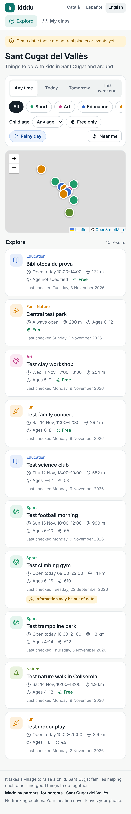
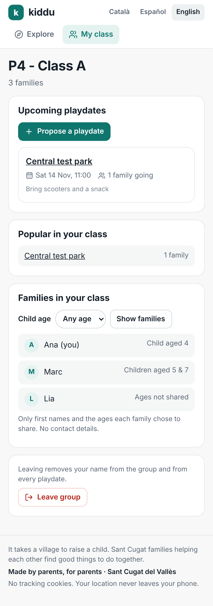
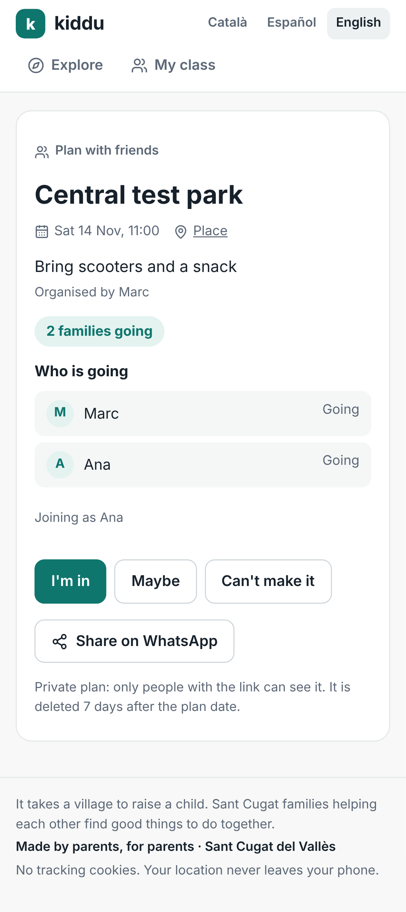
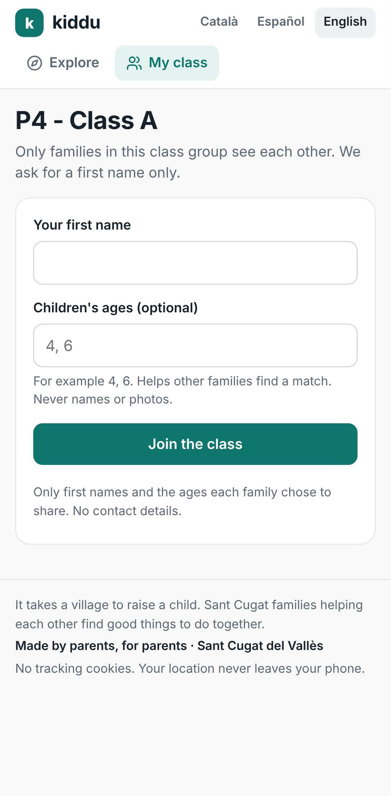

# Kiddu Sant Cugat

Website with places, events and activities for families in Sant Cugat del Vallès and around.
Built acceptance-first (ATDD): the scenarios in `features/` are the specification, owned by the product owner.

> Status: **M1 browse + class groups and playdates** (features 01–04, 08, 09, 12): 40 acceptance scenarios and 20 unit tests pass. Data is a **demo fixture**, not real places yet.

| Explore | Class group | Playdate | Join |
|---|---|---|---|
|  |  |  |  |

## Test site

https://kiddu-santcugat.netlify.app (Netlify, free plan). Right now it is behind **Netlify team login**: only people logged into the owner's Netlify team can open it.

**Storage check after every deploy:** open `/api/health` on the site. It must show `{"store":"netlify-blobs","ok":true}`. Plans, class groups and families are stored in Netlify Blobs when hosted, and in `.data/` locally.

**Environment variable:** `KIDDU_ADMIN_KEY` (set in Netlify > Site configuration > Environment variables) protects class-group creation: `/en/groups/new?key=<KIDDU_ADMIN_KEY>` creates a group and shows its invite link.

Deploy (owner runs it; needs a Netlify token):

```bash
npx netlify-cli build --offline && npx netlify-cli deploy --no-build --dir .netlify/static --prod
# --dir .netlify/static matters: deploying .next leaves out CSS/JS and the site shows unstyled HTML
```

## Run it

```bash
npm install
npm run dev            # http://localhost:3000 → redirects to /ca, /es or /en from your browser language
npm run gate           # typecheck + unit tests + acceptance scenarios (builds the app, ~1 min)
```

Requires Node 22. Acceptance tests use Playwright 1.63 + playwright-bdd on a phone profile (Pixel 7).

## How you control the website

| Lever | File | Example |
|---|---|---|
| What the site does | `features/*.feature` | Change "Then I only see indoor items" or add a scenario; the gate shows what goes red |
| Behaviour values | `config/site.yaml` | `freshness.warn_after_days: 30` → cards older than 30 days show "Information may be out of date" |
| Area | `config/areas.yaml` | Centre and radius of Sant Cugat (verify the centre coordinates) |
| Data sources | `config/sources.yaml` | Used from milestone M2 (pipeline) |
| What runs in the gate | `tests/milestone.ts` | Add `features/05_ask_ai.feature` when that milestone starts |

Agents may not edit `features/` or `config/` (`.claude/settings.json` deny rules; `CODEOWNERS` requires your review).

## Structure

```
app/[lang]/page.tsx            home: filters, map, list (server-rendered, filters in the URL)
app/[lang]/item/[id]/page.tsx  item details, finished events, similar items
components/                    HomeClient (filters, list, "Near me"), MapView (Leaflet + OpenStreetMap), LangSwitch
lib/filters.ts                 the rules: radius, expiry, freshness, theme/age/time/free/indoor
lib/i18n.ts                    Català / Español / English texts
lib/social.ts, social-logic.ts   class groups, plans, RSVPs (rules in social-logic.ts, storage in social.ts + store.ts)
app/api/*                      form endpoints: groups, join, leave, plans, rsvp, cancel, health
app/[lang]/p, g, class, plan   plan page, invite/join page, class page, plan form
lib/server-context.ts          clock, weather (Open-Meteo, no key), test hooks
app/route.ts                   "/" → /ca, /es or /en from the browser language
scripts/build-config.mjs       config/*.yaml → lib/generated/config.json (bundled; no file reads when hosted)
data/catalogue.json            demo catalogue (copy of the test fixture) until the pipeline exists
tests/fixtures/catalogue.json  fixed test data; fixed clock Wed 2026-11-11 10:00
tests/steps/*.ts               step definitions: the scenarios' words, executable
tests/unit/                    Vitest unit tests
```

## What the social features store (read before real families use it)
- **Class group:** name, invite token. **Family (member):** first name, optional children's ages (numbers only), join time, a secret kept in a cookie on their phone.
- **Plan:** place, date and time, note (max 140 characters), first names of families answering. Deleted `plans.delete_days_after_plan` days after the plan date, on first access.
- Leaving a group removes the family's name from the group and from all its plans.
- No children's names or photos, no phone numbers, no emails, no accounts.
- **Before the pilot:** privacy notice, consent wording and a data-retention statement for this data (GDPR; children's ages count as personal data). Not written yet.
- **Known gaps:** no way for an admin to remove a family from a group; no reporting or blocking; no rate limiting on forms; storage has no transactions, so two simultaneous answers to one plan can overwrite each other.

## Privacy (features/08)
No cookies (except test-only hooks when `KIDDU_TEST_HOOKS=1`), no analytics yet, location used only on the phone after consent, no child data.
Map tiles come from OpenStreetMap's tile server; for a public launch, switch to a tile provider with an agreement (OSM's tile policy limits heavy use).

## Next milestones
- **M0 data spike**: 50 real Sant Cugat pages, hand-labelled golden set, Haiku extraction accuracy.
- **M2 pipeline + editor**: features 07, 11; Supabase (EU) replaces `data/catalogue.json`.
- **M3 pilot release**: features 04, 06; legal pages; deploy (Netlify, EU). Deploys and secrets are done by the owner.
